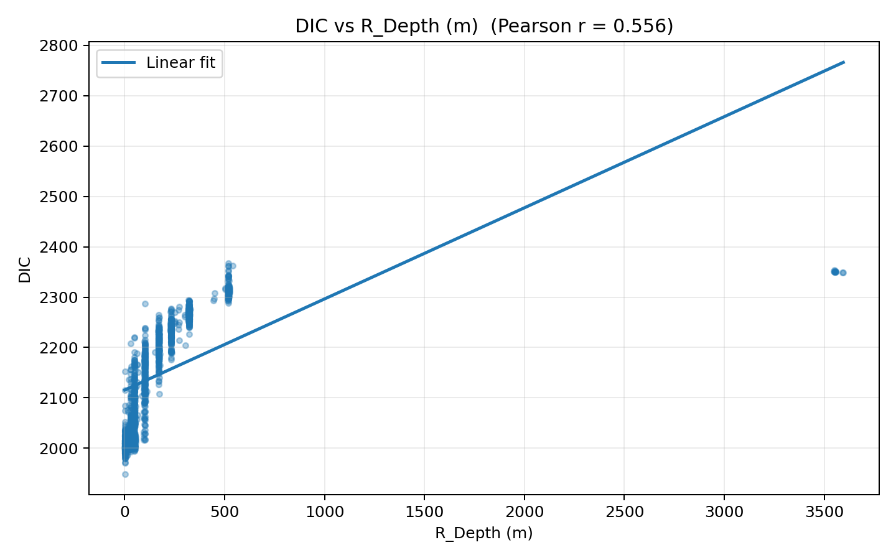
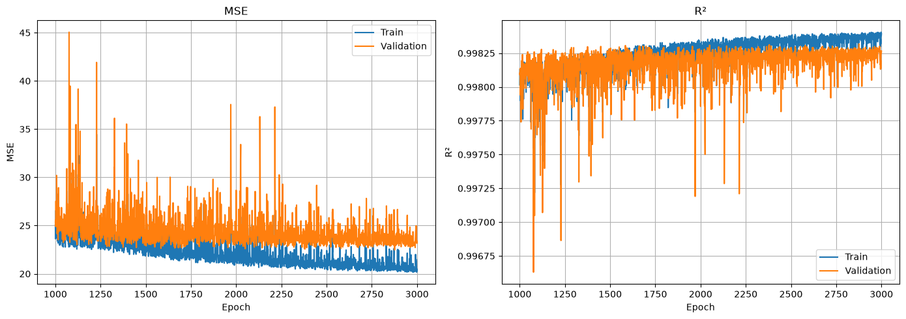

# CalCOFI DIC を予測する MLP

- final score: 4.09542

- コード：[Quiz2401_Yoneyama_Rina.ipynb](https://github.com/74rina/machine_learning/blob/main/Quiz2401_Yoneyama_Rina.ipynb)

# 最適化の記録

ベースラインのスコア：6.05810

## 1. 学習率

学習率を 0.0001 / 0.0003 / 0.001 / 0.003 で比較し、最終検証MSEが最も低くなった 0.001 を採用した。

また、学習率を一定にするのではなく、コサインカーブで学習率を減衰させていくスケジューラ（PyTorchのCosineAnnealingLR）を導入することで、検証MSEを 39.1272 → 34.4822 にすることができた。

学習率の更新において plateau も試し、改善が見られたが、改善幅が小さかった。

この時点のスコア：5.31838

## 2. 重み更新を AdamW にする

過学習気味だった（学習曲線の保存に失敗）ので、重み更新時に減衰も入れる AdamW を採用した。

Adam から AdamW（weight_decay=0.020）に変えたことで、検証MSEが 29.8661 → 26.3020 に改善した。

学習率の減衰も、Adam → AdamW もやったので、重み更新部分はもういいかな...

この時点のスコア：5.18956

## 3. エポックのEarly Stopping（不採用）

Validation MSEの最良値が更新されてから、patience=400エポックだけ待って改善しなければ学習を終了する。検証MSEが最小のエポックにおける重みを採用する。

今回は、精度が改善しなかったため不採用。元々あまり過学習してないので不採用で良い。

この時点のスコア：5.30797（悪化）

## 4. 損失関数を Huber Loss にする

損失関数を MSE、Huber、Pseudo-Huber に変化させて比較実験を行った。

| 学習損失                 |          最終検証MSE |     平均検証R² |
| ------------------------ | -------------------: | -------------: |
| **Huber（δ=5）**         | **26.3020 ± 0.6925** | **0.99803241** |
| Pseudo-Huber（δ=5）      |     26.4368 ± 0.8422 |     0.99802230 |
| Huber（δ=10）とMSEの混合 |     26.4807 ± 1.1058 |     0.99801904 |
| MSE（従来）              |     29.8661 ± 1.0981 |     0.99776578 |

上記の結果より、Huber（δ=5）を採用した。

この時点のスコア：4.81771

## 5. 活性化関数を CELU にする

活性化関数を、ReLU、LeakyReLU、GELU、SiLU、Mish、ELU、Softplus、CELU に変化させて比較実験を行った（AIがやった）。

ReLU → CELU(alpha=3) で 27.1976 → 24.1707 と最も改善したので採用した。

この時点のスコア：4.13254

## 6. 今までのハイパーパラメータを最強にする

ベイズ最適化でハイパラの組を探索するPythonライブラリ「Optuna」を発見したので使った。

7項目（隠れ層のユニット数、CELU alpha、学習率、Weight Decay、Huber delta、バッチサイズ）を32試行で探索し、次の組み合わせにおいて検証MSEが最良だった。

| パラメータ    |         値 |
| ------------- | ---------: |
| hidden1       |        256 |
| hidden2       |         64 |
| CELU alpha    |        2.5 |
| Learning rate | 0.00066139 |
| Weight decay  | 0.01382083 |
| Huber delta   |         10 |
| Batch size    |         64 |

その後、学習率0.001、weight decay 0.025に手動で調節したところ、Kaggleのスコアが上がった。

この時点のスコア：4.10335

## 7. 5-fold Ensemble （不採用）

`train.csv` を5分割し、検証集合を入れ替えながら5回の学習・評価を繰り返す。この5通りのモデルにおける予測値を平均する。

この時点のスコア：4.24441（悪化）

## 8. 特徴量エンジニアリング

前処理で深度の対数を計算し、その値を入力の特徴量として追加したところ、検証MSEが改善した（データを紛失した）。

この原因として、データセットの深度とDICの関係が、下図のようになっていることが考えられる（浅いほど急激に、深いほど緩やかに増える）。

この時点のスコア：4.09542

## 9. 予測値（DIC）も標準化する

元の入力15列に加え、予測対象のDICに対しても標準化を行った。これにより、最終検証MSEが 24.4052 から 22.7517 に改善した。

この時点のスコア：4.04008
