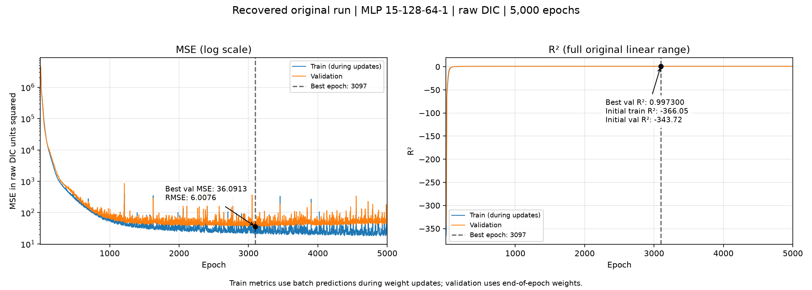
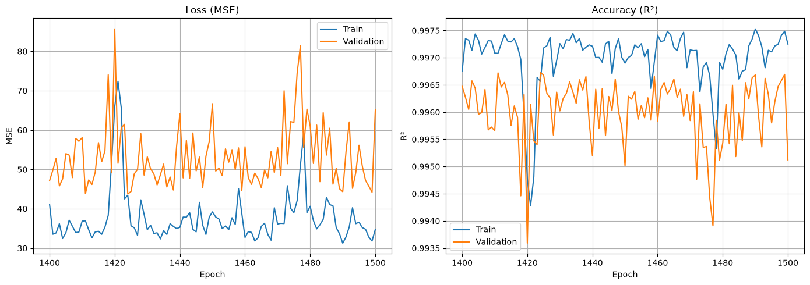
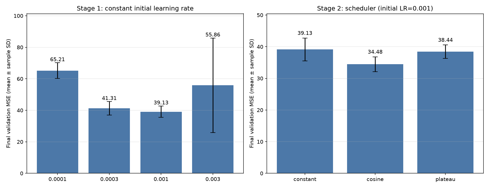
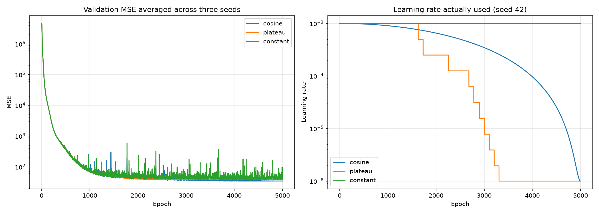

## ベースライン

| 指標      | 検証 MSE 最小時（3,097エポック） | 最終（5,000エポック） |
| --------- | -------------------------------: | --------------------: |
| 訓練 MSE  |                          23.1939 |               18.9545 |
| 検証 MSE  |                      **36.0913** |           **50.9181** |
| 検証 RMSE |                           6.0076 |                7.1357 |
| 訓練 R²   |                         0.998166 |              0.998501 |
| 検証 R²   |                     **0.997300** |          **0.996191** |

### 学習に伴う推移

| エポック  |       訓練 MSE |       検証 MSE |      検証 R² |
| --------- | -------------: | -------------: | -----------: |
| 1         | 4,641,121.0851 | 4,608,102.5000 |  -343.722321 |
| 100       |    15,296.6912 |    15,656.7012 |    -0.171244 |
| 200       |     2,461.0530 |     3,182.1350 |     0.761951 |
| 500       |       293.1813 |       365.7084 |     0.972642 |
| 1,000     |        57.6490 |        71.0327 |     0.994686 |
| 1,500     |        34.7715 |        65.2087 |     0.995122 |
| 2,000     |        30.8683 |        43.7779 |     0.996725 |
| 3,000     |        31.7255 |        47.6031 |     0.996439 |
| **3,097** |    **23.1939** |    **36.0913** | **0.997300** |
| 4,000     |        22.6648 |        45.0176 |     0.996632 |
| 5,000     |        18.9545 |        50.9181 |     0.996191 |

- 最初の500エポックで誤差が大きく減り、1,000エポックで検証 R² は0.994686に達した。
- 後半は訓練 MSE がさらに下がる一方、検証 MSE は上下している。最後の1,000エポックでは中央値50.0266、範囲38.2913〜339.8637で、一時的に大きく悪化するエポックもあった。
- 最終モデルの検証 MSE は最良時より約41.08%大きい。長く学習した最終モデルが最も良いとは限らず、最良重みの保存や Early Stopping を次の比較対象にする根拠になる。ただし、この曲線だけで悪化の原因を過学習と断定はしない。

全期間の学習曲線。左の MSE は、初期の大きな値と後半の変化を同時に確認できるよう対数目盛りで表示した。右の R² は初期の負値を含めた全範囲。

下図は1,400〜1,500エポックの拡大図。

## 学習率の比較（2026-11-12）

### 比較条件と採用基準

現在のノートブックの条件を維持した。入力15特徴量、隠れ層128→64、ReLU、1次元Linear出力、目的変数は元のDICのまま、`nn.MSELoss()`、Adam、訓練・検証バッチサイズ64。訓練1,163行／検証291行を `random_state=42` で分割し、欠損値の平均補完とStandardScalerは訓練側だけで適合させた。`id` と全欠損列を除き、既存の共通列選択を保つため `TA1.x` は含めていない。

各条件をシード42・123・2026、CPU、1スレッド、決定的演算で5,000エポック実行した。Python／NumPy／PyTorchと、訓練DataLoaderの専用Generatorに同じシードを設定した。全条件の初期重みのSHA-256がシードごとに一致し、独立実装で固定学習率0.001の最初の3エポックの損失・R²が共通対照実験と完全一致することも確認した。固定0.001の対照は共通実験の履歴・重みを複製して使用し、同じ5,000エポック実験を重複実行していない。

Early Stoppingと最良重みへの復元は行わず、**5,000エポック後に実際に使う最終モデルのValidation MSEの3シード平均**が小さい条件を採用した。最良MSE・そのエポックは参考値。表は平均±標本標準偏差（`ddof=1`）。

### 第1段階：初期学習率

スケジューラを使わず、学習率1e-4・3e-4・1e-3・3e-3を比較した。

| 初期学習率 | スケジューラ |      最終検証 MSE |       最終 RMSE |             最終 R² | 最良 MSE（参考） |           秒 |
| ---------: | ------------ | ----------------: | --------------: | ------------------: | ---------------: | -----------: |
|     0.0001 | constant     |  65.2065 ± 4.9805 | 8.0712 ± 0.3054 | 0.995122 ± 0.000373 | 63.1640 ± 6.2308 | 44.16 ± 3.04 |
|     0.0003 | constant     |  41.3090 ± 4.2662 | 6.4216 ± 0.3281 | 0.996910 ± 0.000319 | 37.7710 ± 2.5907 | 38.69 ± 2.64 |
|      0.001 | constant     |  39.1272 ± 3.6208 | 6.2507 ± 0.2901 | 0.997073 ± 0.000271 | 34.1742 ± 3.1565 | 39.37 ± 4.88 |
|      0.003 | constant     | 55.8587 ± 30.0233 | 7.3001 ± 1.9625 | 0.995821 ± 0.002246 | 24.7331 ± 0.3900 | 35.82 ± 1.43 |

第1段階では初期学習率 **0.001** が最終MSE平均で最良だった。この値を第2段階の全条件で固定した。

### 第2段階：学習率スケジューラ

- `constant`：学習率を固定。
- `plateau`：`ReduceLROnPlateau(mode="min", factor=0.5, patience=100, threshold=1e-4, min_lr=1e-6)`。
- `cosine`：`CosineAnnealingLR(T_max=5000, eta_min=1e-6)`。

エポックの全バッチ更新と検証の後に1回だけスケジューラを進める。Plateauにはそのエポックの検証MSEを渡す。履歴の `learning_rate` は更新後の翌エポック用学習率ではなく、当該エポックで実際に使った値。constantは第1段階の同一結果を再利用した。

| 初期学習率 | スケジューラ |     最終検証 MSE |       最終 RMSE |             最終 R² | 最良 MSE（参考） |           秒 |
| ---------: | ------------ | ---------------: | --------------: | ------------------: | ---------------: | -----------: |
|      0.001 | cosine       | 34.4822 ± 2.3383 | 5.8699 ± 0.1985 | 0.997420 ± 0.000175 | 33.8882 ± 2.5775 | 33.85 ± 2.46 |
|      0.001 | plateau      | 38.4395 ± 2.1363 | 6.1983 ± 0.1735 | 0.997124 ± 0.000160 | 38.0403 ± 2.4249 | 34.31 ± 0.36 |
|      0.001 | constant     | 39.1272 ± 3.6208 | 6.2507 ± 0.2901 | 0.997073 ± 0.000271 | 34.1742 ± 3.1565 | 39.37 ± 4.88 |

### 採用設定

**初期学習率0.001／cosine** を採用し、ノートブックの既定値に反映した。最終検証MSEは **34.4822 ± 2.3383**、再現可能な固定0.001の対照 **39.1272 ± 3.6208** に対して平均MSEが **11.87%** 改善した。学習率以外のモデル構造・バッチサイズ・前処理・エポック予算は変更していない。採用設定のシード42をノートブックで実際に学習・描画し、最終重みの保存と再読み込み後の検証MSE一致を確認した。

### 全シードの結果

| 初期学習率 | スケジューラ | シード | 最終訓練MSE | 最終検証MSE | 最終検証RMSE | 最終検証R² | 最良検証MSE | 最良エポック | 更新回数 |    秒 |
| ---------: | ------------ | -----: | ----------: | ----------: | -----------: | ---------: | ----------: | -----------: | -------: | ----: |
|     0.0001 | constant     |     42 |     48.2189 |     70.9170 |       8.4212 |   0.994695 |     70.1786 |         4987 |    95000 | 40.65 |
|     0.0001 | constant     |    123 |     45.2695 |     61.7621 |       7.8589 |   0.995380 |     61.0421 |         4991 |    95000 | 46.13 |
|     0.0001 | constant     |   2026 |     44.9119 |     62.9402 |       7.9335 |   0.995292 |     58.2714 |         4981 |    95000 | 45.69 |
|     0.0003 | constant     |     42 |     21.1297 |     39.6523 |       6.2970 |   0.997034 |     35.5253 |         4631 |    95000 | 41.71 |
|     0.0003 | constant     |    123 |     21.0481 |     46.1550 |       6.7937 |   0.996547 |     40.6054 |         4167 |    95000 | 37.58 |
|     0.0003 | constant     |   2026 |     21.6762 |     38.1197 |       6.1741 |   0.997148 |     37.1823 |         4991 |    95000 | 36.80 |
|      0.001 | constant     |     42 |     24.0748 |     39.2650 |       6.2662 |   0.997063 |     37.7632 |         2482 |    95000 | 33.74 |
|      0.001 | constant     |    123 |     19.2774 |     42.6771 |       6.5328 |   0.996807 |     31.8300 |         4259 |    95000 | 42.37 |
|      0.001 | constant     |   2026 |     21.7770 |     35.4395 |       5.9531 |   0.997349 |     32.9293 |         4377 |    95000 | 42.01 |
|      0.001 | cosine       |     42 |     19.0448 |     32.3269 |       5.6857 |   0.997582 |     31.9221 |         3459 |    95000 | 34.66 |
|      0.001 | cosine       |    123 |     19.7242 |     36.9682 |       6.0801 |   0.997234 |     36.8063 |         4258 |    95000 | 35.81 |
|      0.001 | cosine       |   2026 |     18.6538 |     34.1515 |       5.8439 |   0.997445 |     32.9361 |         3316 |    95000 | 31.10 |
|      0.001 | plateau      |     42 |     24.7194 |     39.1944 |       6.2605 |   0.997068 |     38.7904 |         2802 |    95000 | 33.89 |
|      0.001 | plateau      |    123 |     24.8473 |     40.0957 |       6.3321 |   0.997001 |     40.0015 |         2613 |    95000 | 34.49 |
|      0.001 | plateau      |   2026 |     23.9109 |     36.0282 |       6.0024 |   0.997305 |     35.3289 |         1605 |    95000 | 34.54 |
|      0.003 | constant     |     42 |     75.3186 |     89.4266 |       9.4566 |   0.993310 |     24.4588 |         2792 |    95000 | 35.13 |
|      0.003 | constant     |    123 |     22.7501 |     31.5718 |       5.6189 |   0.997638 |     24.5609 |         2340 |    95000 | 37.46 |
|      0.003 | constant     |   2026 |     26.6262 |     46.5776 |       6.8248 |   0.996516 |     25.1796 |         4749 |    95000 | 34.86 |

## AdamW の weight decay（2026-11-12）

現行ノートブックの AdamW（初期学習率 `0.001`、コサインアニーリングの下限 `1e-6`）を使い、シード42・123・2026で各条件を5,000エポック学習した。データ分割のシードは42、バッチサイズは64。平均補完は訓練分割で適合させ、標準化は現行コードどおり検証分割を含む訓練CSVの全1,454行で適合させた。各シードの初期重みの SHA-256 は候補間で一致した。

`0.020`〜`0.030` を `0.001` 刻みで比較し、首位の `0.020` の近傍で `0.0205` を追加した。5,000エポック目の検証MSEを3シードで平均し、最小の値を採用した。表のばらつきは標本標準偏差。

| `weight_decay` | シード42 | シード123 | シード2026 |  平均 ± 標本標準偏差 |
| -------------: | -------: | --------: | ---------: | -------------------: |
|    **`0.020`** |  27.2879 |   30.9323 |    30.2137 | **29.4780 ± 1.9304** |
|       `0.0205` |  29.1694 |   30.5476 |    29.9424 |     29.8865 ± 0.6908 |
|        `0.021` |  28.8650 |   30.9605 |    28.8681 |     29.5646 ± 1.2089 |
|        `0.022` |  30.7875 |   29.4957 |    29.3139 |     29.8657 ± 0.8035 |
|        `0.023` |  29.6985 |   30.3845 |    30.1232 |     30.0687 ± 0.3463 |
|        `0.024` |  29.0554 |   31.6532 |    28.9296 |     29.8794 ± 1.5375 |
|        `0.025` |  28.7708 |   30.9670 |    29.8606 |     29.8661 ± 1.0981 |
|        `0.026` |  31.5643 |   29.6868 |    29.3775 |     30.2095 ± 1.1834 |
|        `0.027` |  27.3320 |   31.7117 |    30.6255 |     29.8898 ± 2.2807 |
|        `0.028` |  29.1043 |   31.4518 |    30.1445 |     30.2335 ± 1.1763 |
|        `0.029` |  29.7407 |   30.2168 |    30.8265 |     30.2613 ± 0.5443 |
|        `0.030` |  30.5813 |   30.2554 |    30.2186 |     30.3518 ± 0.1996 |

**`weight_decay=0.02` を採用した。** 従来値 `0.025` の同条件での再学習と比べ、最終検証MSEの平均は 29.8661 から 29.4780 に下がった（1.30%低下）。採用値でノートブック全体を再実行し、シード42の最終検証MSE 27.2879（RMSE 5.2238、R² 0.997959）が比較時と一致することを確認した。

各試行、集計、実験条件は [runs.csv](output/adamw/runs.csv)、[aggregate.csv](output/adamw/aggregate.csv)、[protocol.json](output/adamw/protocol.json) に記録した。

ただし kaggle の private score が最良になるのは weight_decay=0.025 のとき。

## 損失関数の比較（2026-11-12）

現行の DIC 回帰 MLP（15→128→64→1、ReLU）で、14系統48設定をシード42・123・2026で各5,000エポック学習した。分割はシード42で訓練1,163件・検証291件。バッチサイズ64、AdamW（初期学習率0.001、`weight_decay=0.025`）、コサインアニーリング（下限1e-6）を固定した。平均補完は訓練分割、標準化は検証分割を含む訓練CSV全体で適合させた。CPU・1スレッドで決定的演算を使い、シードごとに初期重みとミニバッチ順をそろえた。

5,000エポック目の検証MSEの3シード平均で選定した。表のばらつきは標本標準偏差。従来のMSEは再学習し、[AdamWの比較記録](../adamw/runs.csv)の同条件の値と全シードで一致した。

| 学習損失                 |          最終検証MSE |     平均検証R² |
| ------------------------ | -------------------: | -------------: |
| **Huber（δ=5）**         | **26.3020 ± 0.6925** | **0.99803241** |
| Pseudo-Huber（δ=5）      |     26.4368 ± 0.8422 |     0.99802230 |
| Huber（δ=10）とMSEの混合 |     26.4807 ± 1.1058 |     0.99801904 |
| MSE（従来）              |     29.8661 ± 1.0981 |     0.99776578 |

**`nn.HuberLoss(delta=5)` を採用した。** 平均検証MSEは従来比で11.93%低下した。採用版のシード42では最終検証MSE 26.4941、RMSE 5.1472、R² 0.998018を再現した。

全144試行は [runs.csv](runs.csv) に記録した。数値の添字は `lp` では絶対残差のべき指数、Huber・Pseudo-Huber・Log-cosh・Fair ではDIC単位の尺度、Quantile・Expectile では非対称重み、`epsilon_l1/l2` では絶対残差から引く許容幅を表す。`rmse_batch` は `sqrt(バッチMSE + 1e-6)`、`relative_mse_p` は `(2150 / max(|DIC|, 1))^p` で重み付けしたMSE、`huber_mse_δ_a` は `(1−a) × Huber(δ) + (a/2) × MSE`。
